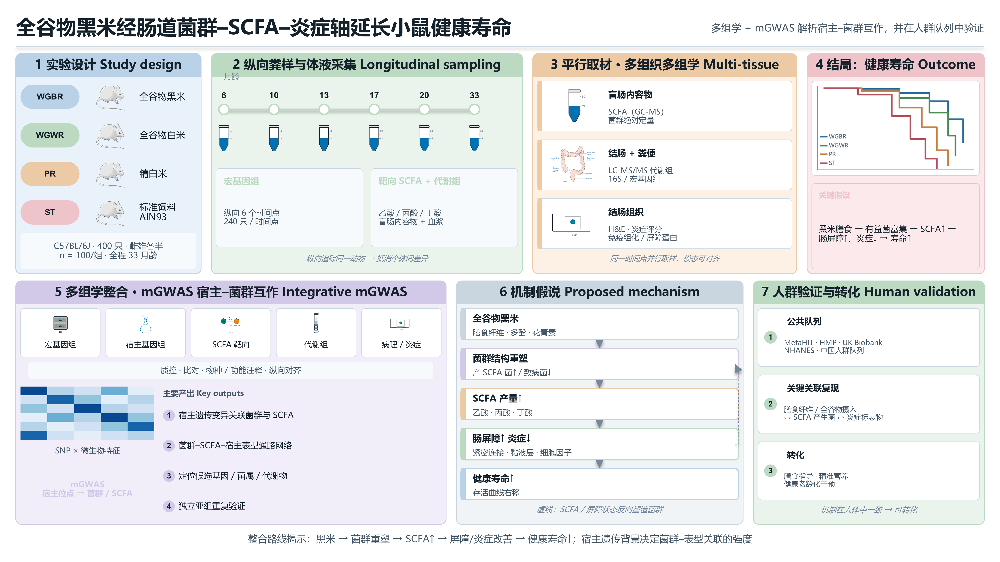
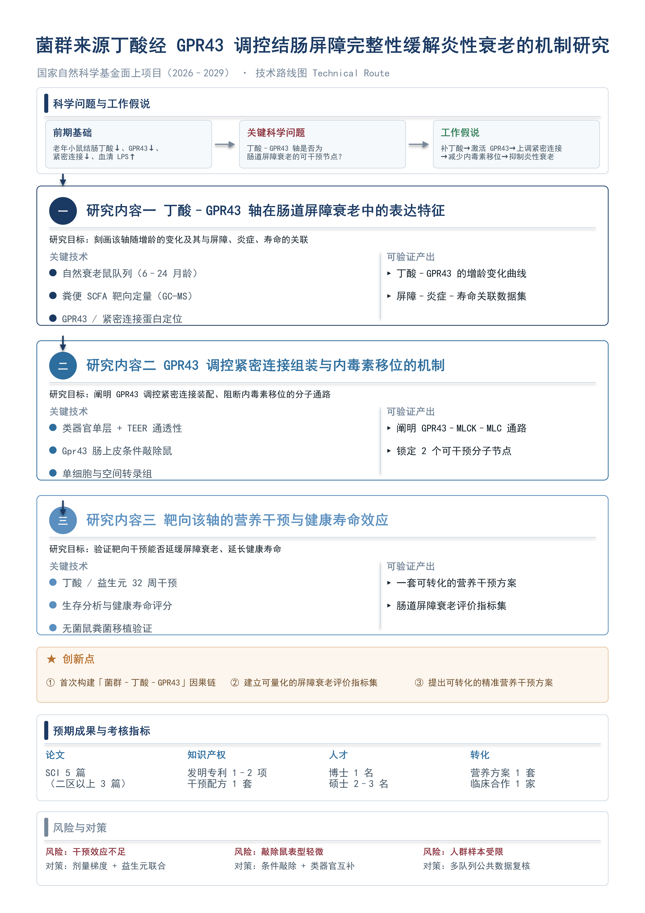
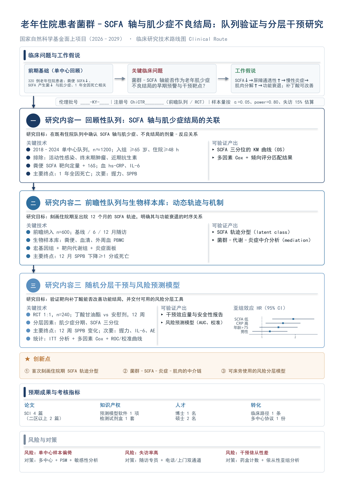
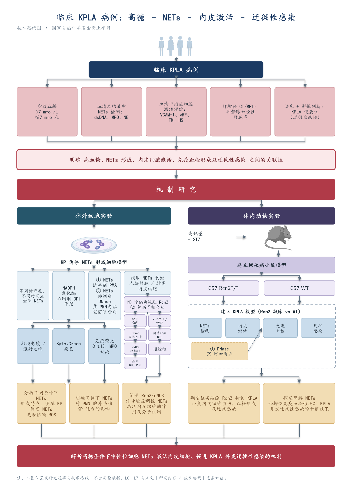
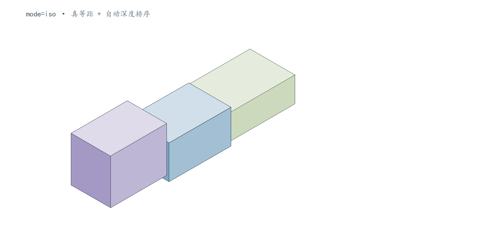

# 科研技术路线绘制模式（tech-route）

一个 DeepSeek Harness Agent 预设：把论文的研究设计、实验流程、多组学整合、机制假说、人群验证
画成**期刊级多面板技术路线图 / 图形摘要**，输出可编辑 `.pptx` + 600 dpi `.png` + 矢量 `.pdf`。

```
tech-route/
├─ cordis.patch.yml          # 预设组合（persona + 5 个技能 + 完整标准能力）
├─ package.json              # @local/dsh-preset-tech-route
├─ assets/
│  ├─ sciglyph/              # 2830 个矢量图元（CC BY 4.0，12 大类 5 种画风）
│  ├─ bioicons/              # 100 个精选插画（CC0 / CC BY，离线可用）
│  ├─ custom/                # 22 个自制/参考素材 + SciDraw 774 个插画
│  ├─ index.json             # 3726 条本机素材索引（中英名、标签、风格、许可、署名）
│  ├─ glossary.json          # 中英术语，供中文检索用
│  └─ remote/
│     ├─ index.json          # 4978 条云端素材目录（元数据 2.2 MB，按需下载）
│     └─ sheets/             # 六张主题目录页：器官/细胞/仪器/微生物/人物/临床
├─ tools/
│  ├─ build_index.py         # 重建本机索引（sciglyph + bioicons + custom + scidraw）
│  ├─ build_cloud_sheets.py  # 重建云端主题目录页（来源优先 + 亮度闸 + 同族折叠）
│  ├─ fetch_bioicons.py      # 拉取精选 Bioicons 子集
│  └─ fetch_scidraw.py       # 从 scidraw.io 公共 API 全量抓取 774 件
├─ skills/
│  ├─ tech-route-atlas/      # 核心方法 + routekit 库 + 示例（含 7 分区示范图）
│  │  ├─ references/api.md       # 全部 API 签名（canvas / miniplot / iso / render3d）
│  │  ├─ references/patterns.md  # 版式骨架（真实坐标），含 GWAS Manhattan 面板
│  │  ├─ references/arrows.md    # 箭头拓扑与走位规则
│  │  ├─ references/iso-3d.md    # 立体图三档：等距体块 / 物体级 3D / 2.5D 剖面
│  │  ├─ references/remote.md    # 云端素材库用法与许可
│  │  └─ examples/               # build_demo / build_iso_paddy / 3d-capability + 成品
│  ├─ sciglyph-catalog/      # 素材检索/预览/许可与格式规则（本机 + 云端）
│  │  └─ references/cloud.md     # 云端库构成、六张主题页、质量闸、缺口对照
│  ├─ nsfc-route/            # 国自然 A4 竖版技术路线图（评审视角 + 六构型 + 临床分册）
│  │  ├─ references/archetypes.md      # 六种获批构型（含树状汇流 F）骨架与坐标
│  │  ├─ references/checklist.md       # 送审前 20 条自查 + 与期刊图差异
│  │  ├─ references/clinical.md        # 队列/干预/RCT 三构型 + 统计图选择
│  │  ├─ references/prompt-template.md # 开工前该给什么（三档介入 + 六项内容）
│  │  ├─ templates/flowtree_template.py # 树状汇流模板：几何写死，只改 BRIEF 字典
│  │  └─ examples/                     # 基础版 / 临床版 / KPLA 复刻 + 成品三件套
│  ├─ route-visual-qa/       # 渲染、审计、10 点人工复查
│  └─ journal-route-spec/    # 期刊画布/字号/配色/图注规范与双输出
│     ├─ references/scenarios.md  # 六场景 × 十参数（期刊/GA/论文/组会/标书/结题）
│     └─ templates/brief-*.md     # 期刊 / 组会 / 标书 三张填空卡
├─ docs/SOURCES.md           # 素材来源与许可
├─ docs/ATTRIBUTION.md       # 可直接抄的署名片段
└─ docs/USER_PRESET.md       # 用户审美 / 布局 / 字体与交付硬约束
```

## 素材：本机 3726 + 云端 4978

本机 3726 件开箱即用（离线）：SciGlyph 2830、Bioicons 精选 100、SciDraw 774、自制/参考 22（含临床口：医护团队、病房、输液、采血管、病历、影像机架、人群队列、问卷、样本库）。
SciDraw 来自 <https://scidraw.io>（CC BY 4.0 / CC0，逐条保留作者、DOI 与许可）。要 BioRender 那种彩色写实插画，用**云端库**——
共 4978 件，其中 **Servier Medical Art 1374 件**（CC BY 3.0）、**DBCLS 634 件**（CC BY 4.0）、
**Reactome 2149 件**（CC BY 4.0）——前两者是人工绘制的彩色插画，脏器、小鼠、菌群、仪器都有。
仓库只带 2.2 MB 目录，图上用到哪张才下载哪张（缓存到 `assets/.remote/`，附许可文件）。
六张主题目录页（器官/细胞/仪器/微生物/人物/临床）在 `assets/remote/sheets/`，
挑素材前先翻一遍；细读 `skills/sciglyph-catalog/references/cloud.md`。

```powershell
python -m routekit.remote search "心脏" -k 8 --sheet out\cardiac.png
python -m routekit.remote search "colon" -c servier
python -m routekit.remote fetch bioicons/servier/Human_physiology/colon
```

写代码时直接写 id，`cv.icon(box, "bioicons/servier/Animals/mouse-gray")` 首次使用自动下载。

## 快速上手

```powershell
cd <本预设>\skills\tech-route-atlas\scripts
$env:PYTHONIOENCODING = 'utf-8'
python build_demo.py D:\out            # 生成示范图 pptx/png/pdf 并打印审计
python -m routekit.icons search "肠道菌群" -k 8 --sheet out\sheet.png
python -m routekit.remote search "goblet" -k 8 --sheet out\goblet.png   # 云端 4978 件
```

挑云端素材之前，先翻 `assets/remote/sheets/` 那六张主题目录页（器官 / 细胞 / 仪器 /
微生物 / 人物 / 临床），比逐条搜关键词快得多。

在自己的脚本里：

```python
from routekit import Canvas, Box, P, T, CANVAS, P as palette
from routekit import miniplot as mp
from routekit.audit import static_report, format_report

cv = Canvas(*CANVAS.slide_16x9, palette="cell",
            font="Cambria", cjk_font="KaiTi", title="研究技术路线")
c = cv.zone(Box(4, 20, 120, 60), "1 实验设计 Study design", acc=0)
cv.text(Box(c.x, c.y, c.w, 6), "全谷物黑米 × 4 组 × 33 月龄", size=T.small, bold=True)
cv.icon(Box(c.x, c.y + 8, 18, 18), "bioicons/Mouse")
cv.save("D:/out/route.pptx")
cv.export("D:/out", dpi=600)          # → route.png / route.pdf
print(format_report(static_report(cv, mode="deck")))
```



## 两种场景，两个入

| 场景 | 技能 | 画布 | 关键约束 |
|---|---|---|---|
| 期刊投稿 / 图形摘要 / 论文插图 | `tech-route-atlas` + `journal-route-spec` | 254×142.9、300×189.5 横版 | 字号 ≥5.5 pt，KaiTi + Cambria |
| 组会 / 答辩 / 结题汇报 | `tech-route-atlas` + `journal-route-spec` | 254×142.9 横版，一屏讲完 | 字号 ≥5.5 pt，≤7 个分区，标题 18 pt |
| **国自然 / 中文基金标书** | `nsfc-route` | **A4 竖版 210×297** | 单页不跨页，SimHei，**字号 ≥8 pt**，模块必须有可验证产出 |

国自然那条线的范例（可直接改文案用）：

```powershell
cd skills\nsfc-route\examples
python build_nsfc_a4.py            # 基础研究口 → out/nsfc-a4-demo.pptx / .png(600dpi) / .pdf
python build_clinical_a4.py        # 临床研究口（队列+RCT+森林图）→ out/nsfc-clinical-demo.*
python build_flowtree_a4.py        # 树状汇流式（扇出/汇总总线）→ out/nsfc-flowtree-demo.*
```

**最省事的起点是模板**：`skills/nsfc-route/templates/flowtree_template.py` —— 几何全部写死，
内容集中在一个 `BRIEF` 字典里，改字即出图：

```powershell
cd skills\nsfc-route\templates
python flowtree_template.py        # → out/flowtree.pptx / .png(600dpi) / .pdf
```







## 立体图：默认平面，按需立体

大部分技术路线图是平面的；当**空间关系本身是信息**（田块/土层/流域/器官剖面）时才上立体。
三档，按需要选：

| 档 | 用什么 | 产物 | 适合 |
|---|---|---|---|
| A 等距体块场景 | `routekit.iso`（`iso_block / iso_layers / iso_plane / iso_scene`） | 纯矢量，PPTX 可改 | 土壤剖面、田块、装置、房舍 |
| B 物体级 3D | `routekit.render3d`（plotly + kaleido，离线） | 600 dpi 位图 | 病毒、细胞、纳米颗粒、分子球棍 |
| C 只要"分层" | `sciglyph/05-ecology-biotech/habitats/*` | 现成矢量 | 水体、土壤、肠腔剖面 |

规则（硬）：文字**一律水平放体块外**（PPTX 无 shear）；一张图只许一种进深比；禁渐变/投影/天空盒，
立体感只由三面明度承担。细节见 `skills/tech-route-atlas/references/iso-3d.md`。



## 安装到 DeepSeek Harness

```powershell
git clone https://github.com/lxwang98/dsh-preset-tech-route.git D:\dsh-bundles\tech-route
```

然后在 DeepSeek Harness 里二选一：

1. **插件管理器**（图形界面）：安装本地 bundle，目录选克隆下来的 `tech-route`；
2. **手动注册**（等价操作）：在 profile 的 `package.json` 里加

   ```json
   "dependencies": { "@local/dsh-preset-tech-route": "link:D:/dsh-bundles/tech-route" }
   ```

   并把 `"@local/dsh-preset-tech-route"` 加进 `dsh.profile.bundles` 数组，然后 `pnpm install` 并重启 Harness。

装好后新建对话，在预设选择器里选 **「科研技术路线绘制模式」**。

> 包名带 `@local/` 前缀只是本机约定。改成自己的 scope（如 `@lxwang98/dsh-preset-tech-route`）时，
> 要同步改 `package.json`、profile 依赖、`dsh.profile.bundles` 三处，以及 `cordis.patch.yml`
> 里 `customSkillDirs` 那行解析 `@local/dsh-preset-tech-route/package.json` 的写法。

## 依赖

python-pptx、matplotlib、Pillow、PyMuPDF、svglib+reportlab、pywin32，以及本机安装的
Microsoft PowerPoint（仅作渲染/导出/审计引擎，无需人工打开）。

## 许可

- 代码与技能文档：随本预设自由使用。
- SciGlyph：CC BY 4.0（署名 ZengZichao）；Bioicons：逐文件 CC0 / CC BY 3.0 / CC BY 4.0；
  SciDraw：逐文件 CC BY 4.0 / CC0，保留作者、DOI 与来源。
- 云端库：Servier Medical Art CC BY 3.0、DBCLS/Togo picture gallery CC BY 4.0、
  Reactome Icon Library CC BY 4.0、openclipart CC0 —— 逐件许可写在目录里，
  下载时同时落一份 `.license.txt`；**CC BY-SA 件不用于投稿图**。
- BioRender 素材**不在本库**：其许可只允许在自家编辑器内使用，禁止提取与再分发。
- 对外交付图件请附 `docs/ATTRIBUTION.md` 中的署名片段。详见 `docs/SOURCES.md`。


